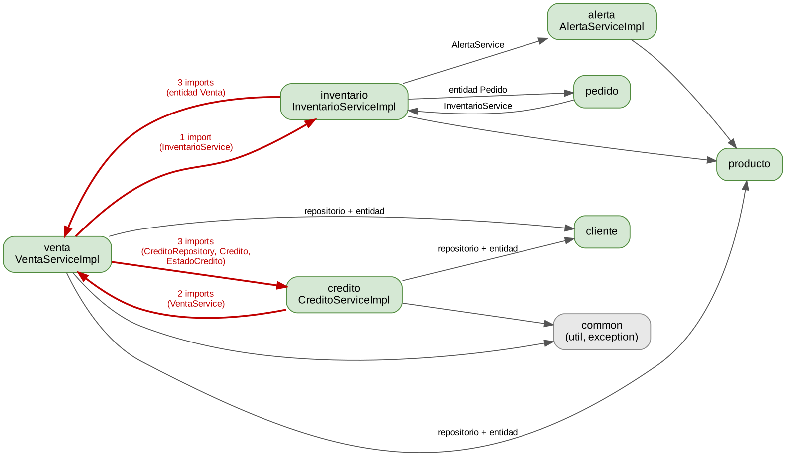
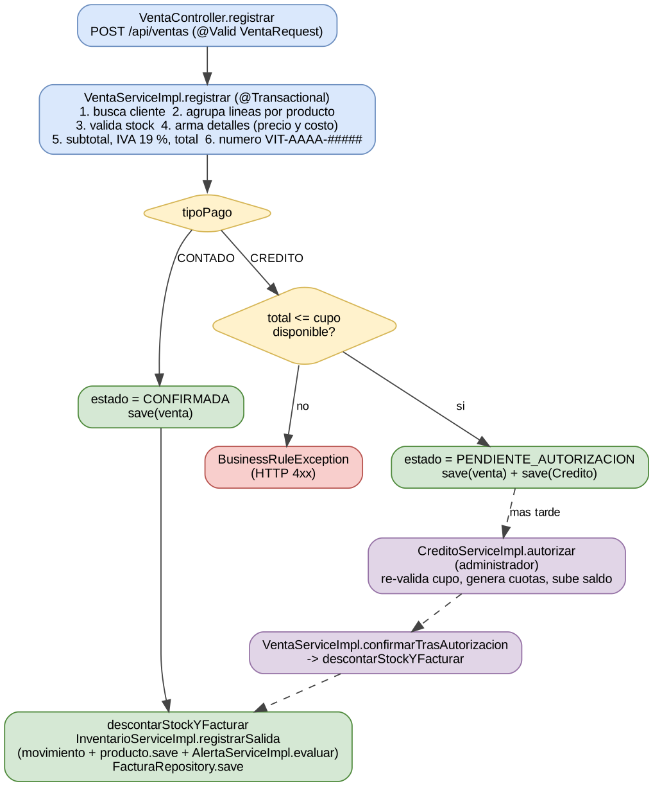
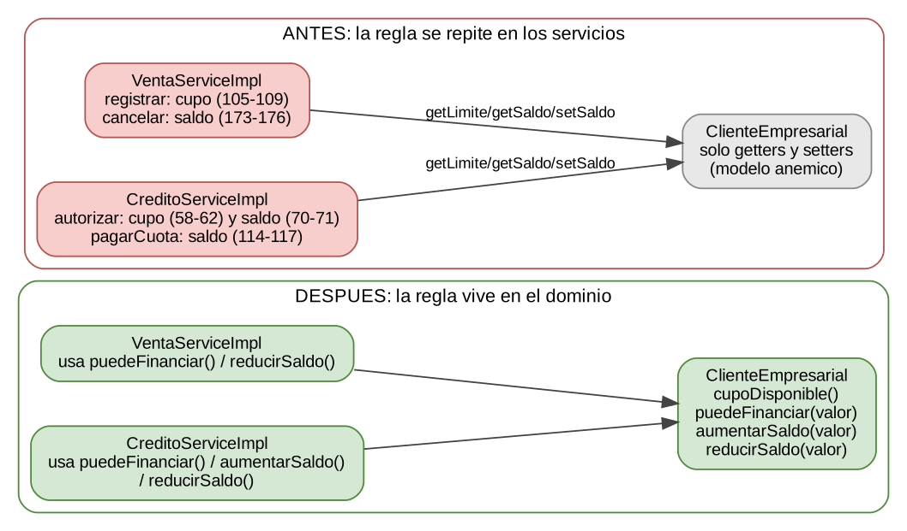

# Diagnóstico técnico y refactorización — SIVITRIX

**Taller de refactorización y cierre de arquitectura** · Ingeniería de Software II · Universidad del Quindío

- **Estudiante:** Juan David Arango Valencia (juand.arangov@uqvirtual.edu.co)
- **Docente:** Juan Manuel Cardona Arias
- **Funcionalidad:** Registrar venta (F-01) y autorizar crédito (F-05)
- **Versión:** 1.0 · 26 de octubre de 2026

# 0. Cómo leer este documento

Este informe sigue el artefacto obligatorio del taller (`docs/refactorizacion/DIAGNOSTICO_REFACTORIZACION.md`, secciones 1 a 8) y agrega la lista de inspección técnica y la pregunta de cierre.

Todo lo que se afirma sobre el código proviene de leer los archivos de las ramas `main` de los repositorios en GitHub (backend commit `4bca0ba`, frontend commit `db05cb8`). Los números de línea corresponden a esos commits. Lo que depende de ejecutar el sistema se marca como **hipótesis**. Los textos <mark>resaltados en amarillo</mark> son los únicos datos que faltan: los resultados de `mvn test` y los hashes de los commits, que solo existen cuando se ejecuta y se sube el trabajo.

| Sección del taller | Estado | Observación |
|---|---|---|
| 1. Contexto | Completa | Equipo, docente, repositorios y requisitos definidos. |
| 2. Arquitectura real | Completa | Basada en lectura de código; no se ejecutó la aplicación. |
| 3. Hallazgos | Completa | 7 fichas (el taller exige al menos 3); 2 son hipótesis por verificar. |
| 4. Priorización | Completa | Escala 1 a 3; selecciona H-02. |
| 5. Intervención | Completa | Código del refactor y de las pruebas entregado y revisado; se aplica en el repositorio siguiendo la sección 8. |
| 6. Verificación | Parcial | 36 pruebas «antes» y 43 «después» definidas; falta pegar la salida de `mvn test` (sección 6.4). |
| 7. Cierre | Completa | Incluye respuesta a la pregunta de cierre. |
| 8. Git | Parcial | Orden y mensajes de commit definidos; faltan los hashes al subirlos. |

# 1. Contexto

| Elemento | Detalle |
|---|---|
| Equipo | Juan David Arango Valencia (juand.arangov@uqvirtual.edu.co) · entrega individual |
| Asignatura | Ingeniería de Software II · Universidad del Quindío · Docente: Juan Manuel Cardona Arias |
| Sistema | SIVITRIX, sistema de ventas, inventario, clientes, proveedores y crédito de Vitrix (repuestos para motocicletas al por mayor). |
| Repositorio backend | https://github.com/J-Dav-A/sivitrix_backend (Java 21, Spring Boot 3.3.4, JPA, PostgreSQL, Flyway, MapStruct). Commit analizado: `4bca0ba`. |
| Repositorio frontend | https://github.com/J-Dav-A/sivitrix_frontend (Angular 18, Material). Commit analizado: `db05cb8`. |
| Funcionalidad | **Registrar venta** (F-01) y su continuación **Autorizar venta a crédito** (F-05). Es una transacción de negocio que toca nueve entidades: Venta, DetalleVenta, Producto, MovimientoInventario, AlertaStock, Factura, Credito, Cuota y ClienteEmpresarial. |
| Requisitos relacionados | F-01, F-05, F-06 (factura), F-07 (alertas de stock) · SWR-19 (IVA 19 %), SWR-20 (redondeo hacia arriba a 2 decimales), SWR-30 (el stock nunca queda negativo), SWR-37 (el saldo de crédito sube con cada crédito aprobado). |
| Arquitectura documentada | Documento de Arquitectura de Software v1.1 (C4 y C4+1): monolito modular por paquetes de dominio con capas Controller → Service (interfaz + Impl) → Repository. |
| Uso de IA | La IA se usó como apoyo para recorrer el código y proponer hallazgos. Cada ubicación y fragmento citado se contrastó contra el archivo fuente; las conclusiones están pendientes de la validación manual del equipo. |

## 1.1 Alcance

- **Backend:** `VentaController`, `VentaService`, `VentaServiceImpl`, `InventarioServiceImpl`, `AlertaServiceImpl`, `CreditoServiceImpl`, `FinanzasUtils`, entidades `Venta`, `DetalleVenta`, `Producto`, `ClienteEmpresarial` y repositorios asociados.
- **Frontend:** `venta-form.component.ts`, `venta.service.ts`, `core/utils/dinero.ts`.
- **Fuera de alcance:** reportes, pedidos a proveedores, gestión de usuarios y configuración de seguridad.
## 1.2 Limitaciones del diagnóstico

- No se ejecutó el backend ni sus pruebas en el entorno de análisis; no se midieron tiempos ni se probó concurrencia.
- La documentación de arquitectura y el Plan de Requisitos V3 se usaron como referencia de lo que se esperaba del sistema.
# 2. Arquitectura real

## 2.1 Componentes y responsabilidades

| Componente | Responsabilidad real | Colabora con |
|---|---|---|
| `VentaController` | Recibe `POST /api/ventas`, valida el cuerpo con `@Valid` y delega. No contiene cálculos ni acceso a datos. | `VentaService`, `FacturaService` |
| `VentaServiceImpl` | Orquesta el registro: busca cliente y productos, valida stock, arma el detalle con precio y costo del momento, calcula subtotal, IVA y total, numera, decide contado o crédito, crea el crédito pendiente, anula ventas y emite la factura. | 5 repositorios, `InventarioService` |
| `InventarioServiceImpl` | Registra entradas y salidas, valida cantidad y stock, guarda el movimiento y pide evaluar la alerta. | `ProductoRepository`, `AlertaService` |
| `AlertaServiceImpl` | Abre, actualiza o cierra la alerta de stock bajo o crítico de un producto. | `AlertaStockRepository` |
| `CreditoServiceImpl` | Autoriza o rechaza el crédito, genera cuotas, actualiza el saldo del cliente y registra pagos. | `VentaService`, 3 repositorios |
| `FinanzasUtils` / `MoneyUtils` | Cálculo de IVA, total, cuotas y redondeo, sin dependencias de Spring. | — |
| Entidades JPA | `Venta`, `DetalleVenta`, `Producto`, `ClienteEmpresarial`: solo mapeo de datos (getters y setters generados con Lombok). | — |

## 2.2 Dependencias entre módulos

La figura resume las dependencias leídas en los `import` de cada paquete (el número es la cantidad de líneas de importación). Las flechas rojas marcan los pares con dependencia en ambos sentidos.



*Figura 1. Dependencias entre módulos en el flujo de ventas (se resaltan los ciclos de paquetes).*

**Hechos observados:** `venta` importa `credito` (3 imports) y `credito` importa `venta` (2); `venta` importa `inventario` (1) e `inventario` importa `venta` (3); `inventario` importa `pedido` (3) y `pedido` importa `inventario` (1). Spring resuelve estos ciclos entre paquetes sin problema, porque entre beans solo hay dependencia en un sentido: `CreditoServiceImpl` depende de `VentaService`, pero `VentaServiceImpl` no depende de `CreditoService`, sino de `CreditoRepository`.

## 2.3 Flujo de la funcionalidad



*Figura 2. Flujo de «Registrar venta» (contado y crédito) y de la autorización posterior.*

Toda la operación corre dentro de una transacción (`@Transactional` a nivel de clase en `VentaServiceImpl`, `InventarioServiceImpl`, `AlertaServiceImpl` y `CreditoServiceImpl`), por lo que cualquier excepción deshace el conjunto: venta, detalle, movimiento, stock, alerta, factura y crédito.

## 2.4 Coherencia con la arquitectura documentada

| Documentado | Observado en el código | Veredicto |
|---|---|---|
| Unit of Work: `@Transactional` en `VentaServiceImpl.registrar` y `CreditoServiceImpl.autorizar`. | Presente a nivel de clase en ambos servicios. | Coincide |
| Facade interna: «un módulo usa a otro solo por su servicio». Pedidos y Ventas llaman a `InventarioService`; Crédito llama a `VentaService`. | Venta → Inventario sí usa el servicio. Pero `VentaServiceImpl` también usa `CreditoRepository`, `ClienteEmpresarialRepository` y `ProductoRepository`, y `CreditoServiceImpl` usa `ClienteEmpresarialRepository`. | **No coincide** (ver H-01) |
| Snapshot: `DetalleVenta.precioUnitario` y `costoUnitario`; `Factura.subtotal`, `iva`, `total`. | `VentaServiceImpl` líneas 81-82 y 204-206. | Coincide |
| Cálculos financieros aislados en `FinanzasUtils` y `MoneyUtils`, probados sin Spring. | IVA, total, cuotas y redondeo se calculan allí. La regla de cupo y saldo de crédito **no**: está dentro de los servicios. | Coincide en parte (ver H-02) |
| Validación en tres niveles (interfaz, servicio, base de datos). | Stock: validación en servicio y `CHECK (stock_actual >= 0)` en V1; cantidad ≥ 1 en `VentaRequest`. | Coincide |

## 2.5 Lista de inspección técnica (taller, sección 3)

| Zona | Qué se observó | Hallazgo |
|---|---|---|
| Controladores | `VentaController` solo delega; no hay cálculos ni acceso a persistencia. Único detalle: `cancelar` recibe un `Map<String,String>` sin DTO. | H-07 |
| Servicios | `VentaServiceImpl` mezcla política de precios, de crédito, de facturación y de numeración, y toca el módulo Crédito directamente. Hay dependencias directas a repositorios de otros módulos. | H-01, H-02 |
| Dominio | Las entidades son anémicas: las invariantes (cupo, saldo no negativo, stock) se aplican en los servicios; la base de datos solo respalda stock y precios con `CHECK`. | H-02, H-03 |
| Código | Reglas de cupo, stock y saldo repetidas; consulta N+1 al listar; nombre de clase completo inline; dos sentencias en una línea. | H-02, H-04, H-07 |
| Arquitectura | Capas respetadas (Controller → Service → Repository), pero hay ciclos entre paquetes y se rompe la regla de Facade entre módulos. | H-01 |
| Pruebas | Solo existen `UtilidadesDominioTest` y `FinanzasUtilsTest`; ninguna prueba cubre los servicios de venta, crédito o inventario. | H-05 |

# 3. Hallazgos

Se documentan siete hallazgos (el taller exige al menos tres). La categoría sigue las definiciones del taller: **defecto** (comportamiento incorrecto), **riesgo arquitectónico**, **deuda técnica** u **oportunidad de mejora**. Cuando algo no se pudo comprobar sin ejecutar el sistema se declara como **hipótesis**.

| ID | Hallazgo | Categoría | Certeza | Estado |
|---|---|---|---|---|
| H-01 | `VentaServiceImpl` opera directamente sobre el módulo Crédito; rompe la regla de Facade documentada | Riesgo arquitectónico | Hecho | Pendiente |
| H-02 | Regla de cupo y saldo de crédito duplicada en dos servicios; entidad anémica | Deuda técnica | Hecho | Seleccionado |
| H-03 | Verificación de stock sin bloqueo: posible pérdida de actualización en ventas simultáneas | Riesgo | Hipótesis | Pendiente |
| H-04 | Listado de ventas: filtro en memoria y consulta N+1 de factura | Oportunidad de mejora | Hecho | Pendiente |
| H-05 | Ninguna prueba cubre los servicios de venta, crédito e inventario | Deuda técnica | Hecho | Parte de la intervención |
| H-06 | El número de cuotas se valida tarde y un crédito puede quedar imposible de autorizar | Defecto potencial | Hipótesis | Pendiente |
| H-07 | Detalles de código limpio y DTO ausente en `cancelar` | Oportunidad de mejora | Hecho | Pendiente |

### H-01 · Responsabilidades y acoplamiento entre módulos

| Campo | Contenido |
|---|---|
| **Tipo** | Riesgo arquitectónico (inconsistencia entre arquitectura documentada e implementada). |
| **Ubicación** | `backend/.../venta/service/VentaServiceImpl.java` · imports 4, 9-11 y 14 · campos 36-41 · `registrar` 44-124 (crédito en 114-121) · `cancelar` 158-192 (crédito en 165-182). |
| **Observación** | La clase de ventas inyecta `CreditoRepository`, `ClienteEmpresarialRepository` y `ProductoRepository`; crea y guarda un `Credito` y, al anular una venta, cambia el estado del crédito y el saldo del cliente. Es decir, decide la política de crédito de un módulo que no le pertenece. Además hay ciclos de paquetes `venta`↔`credito` y `venta`↔`inventario`. |
| **Criterio** | SRP (la clase cambia por cuatro razones: precios e IVA, política de crédito, facturación y numeración de ventas) y acoplamiento entre módulos. Contradice la decisión documentada «un módulo usa a otro solo por su servicio». No se afirma por el tamaño del método, sino por las razones de cambio y por las dependencias directas. |
| **Impacto y riesgo** | Un cambio en las reglas de crédito obliga a modificar y volver a probar el módulo de ventas; no se puede probar Venta sin construir el contexto de Crédito. Riesgo medio: hoy el comportamiento es correcto. |
| **Acción propuesta** | Que `VentaServiceImpl` solicite al módulo de crédito las operaciones «crear solicitud» y «cancelar crédito» mediante una interfaz propia. Cuidado: `CreditoServiceImpl` ya depende de `VentaService`, así que inyectar `CreditoService` en `VentaServiceImpl` crearía una dependencia circular entre beans; hay que usar una interfaz de puerto o eventos de Spring. |
| **Verificación** | Pruebas de caracterización de `registrar` (contado y crédito) y `cancelar` antes y después (casos CP-01 a CP-09). |
| **Estado** | Pendiente (deuda técnica declarada). |

**Evidencia (fragmento literal del código):**

```java
// VentaServiceImpl.java:36-41
private final VentaRepository ventaRepository;
private final FacturaRepository facturaRepository;
private final ClienteEmpresarialRepository clienteRepository;
private final ProductoRepository productoRepository;
private final CreditoRepository creditoRepository;   // repositorio de otro modulo
private final InventarioService inventarioService;
```

```java
// VentaServiceImpl.java:114-121
Credito credito = new Credito();
credito.setVenta(guardada);
credito.setCliente(cliente);
credito.setValorTotal(guardada.getTotal());
credito.setNumeroCuotas(request.numeroCuotas());
credito.setEstado(EstadoCredito.PENDIENTE_AUTORIZACION);
credito.setFechaSolicitud(LocalDateTime.now());
creditoRepository.save(credito);
```

### H-02 · Regla de cupo y saldo de crédito duplicada; entidad anémica

| Campo | Contenido |
|---|---|
| **Tipo** | Deuda técnica (reglas de dominio ubicadas en componentes inadecuados). |
| **Ubicación** | `VentaServiceImpl.registrar` 105-109 y `cancelar` 173-176 · `CreditoServiceImpl.autorizar` 57-62 y 70-71, `pagarCuota` 114-117 · `cliente/entity/ClienteEmpresarial.java` (solo getters y setters). |
| **Observación** | El cálculo «cupo disponible = límite − saldo» y su comparación con el total aparecen en dos servicios, con mensajes casi idénticos. Las actualizaciones del saldo (subir, bajar sin dejarlo negativo y redondear) están en tres puntos. La entidad que posee esos datos no protege ninguna invariante. |
| **Criterio** | DRY y cohesión: la regla pertenece al propietario de los datos (`ClienteEmpresarial`). También afecta Open/Closed: cambiar la política obliga a modificar varios servicios. |
| **Impacto y riesgo** | Si cambia la regla (por ejemplo, contar los créditos pendientes dentro del cupo), hay que acordarse de editar dos o tres lugares; un olvido produciría saldos inconsistentes. Riesgo moderado; esfuerzo bajo. |
| **Acción propuesta** | Agregar a `ClienteEmpresarial` los métodos `cupoDisponible()`, `puedeFinanciar(valor)`, `aumentarSaldo(valor)` y `reducirSaldo(valor)`, y usarlos desde los dos servicios (ver sección 5). Se mantienen los mensajes de error y las interfaces públicas. |
| **Verificación** | Casos CP-03 a CP-08 y CP-11 antes y después; los resultados deben ser idénticos. |
| **Nota** | La validación de stock también aparece dos veces (`VentaServiceImpl` 72-75 e `InventarioServiceImpl` 66-69, con el mismo mensaje). Se interpreta como defensa deliberada (fallar antes de armar el detalle y proteger la salida desde cualquier origen), por lo que **no** se incluye en el cambio. |
| **Estado** | Seleccionado. |

**Evidencia (fragmento literal del código):**

```java
// VentaServiceImpl.java:105-109
BigDecimal disponible = cliente.getLimiteCredito().subtract(cliente.getSaldoCredito());
if (venta.getTotal().compareTo(disponible) > 0) {
    throw new BusinessRuleException("El total de la venta (" + venta.getTotal()
        + ") excede el cupo de credito disponible del cliente (" + disponible.max(BigDecimal.ZERO) + ")");
}
```

```java
// CreditoServiceImpl.java:58-62
BigDecimal disponible = cliente.getLimiteCredito().subtract(cliente.getSaldoCredito());
if (credito.getValorTotal().compareTo(disponible) > 0) {
    throw new BusinessRuleException("No se puede autorizar: el credito (" + credito.getValorTotal()
        + ") excede el cupo disponible del cliente (" + disponible.max(BigDecimal.ZERO) + ")");
}
```

```java
// VentaServiceImpl.java:174-175   |   CreditoServiceImpl.java:115-116
cliente.setSaldoCredito(MoneyUtils.redondear(
    cliente.getSaldoCredito().subtract(credito.getValorTotal()).max(BigDecimal.ZERO)));
// ...
BigDecimal nuevoSaldo = cliente.getSaldoCredito().subtract(cuota.getValor()).max(BigDecimal.ZERO);
cliente.setSaldoCredito(MoneyUtils.redondear(nuevoSaldo));
```

### H-03 · Verificación de stock sin bloqueo (concurrencia)

| Campo | Contenido |
|---|---|
| **Tipo** | Riesgo. **Hipótesis**: no se ejecutó una prueba concurrente. |
| **Ubicación** | `VentaServiceImpl.registrar` 66-75 (lee `stockActual`) · `InventarioServiceImpl.registrarSalida` 63-72 (escribe `stockActual - cantidad`) · `Producto.java` (sin `@Version`; en todo el proyecto no hay `@Version` ni bloqueos `@Lock`). |
| **Observación** | El patrón es leer, comprobar y escribir sin control de concurrencia. Si dos ventas del mismo producto se procesan a la vez con el aislamiento por defecto de PostgreSQL (READ COMMITTED), ambas pueden leer el mismo stock y la segunda sobrescribir a la primera. El `CHECK (stock_actual >= 0)` de V1 evita valores negativos, pero no detecta que se vendió más de lo disponible. |
| **Criterio** | Integridad de datos (SWR-30) y consistencia bajo concurrencia. |
| **Impacto y riesgo** | Inventario inflado respecto a lo físico. La probabilidad es baja con pocos usuarios simultáneos; el impacto sería alto en un día de mucho movimiento. |
| **Acción propuesta** | Bloqueo optimista (`@Version` en `Producto`) o bloqueo pesimista al leer el producto en `registrarSalida`; o decidir y documentar que el riesgo se acepta. |
| **Verificación** | Prueba con dos hilos que vendan el mismo producto con stock 5 y cantidad 3 cada uno, sobre PostgreSQL real. Hoy no se ha ejecutado. |
| **Estado** | Pendiente. |

**Evidencia (fragmento literal del código):**

```java
// VentaServiceImpl.java:72-75
if (producto.getStockActual() < cantidad) {
    throw new BusinessRuleException("Stock insuficiente para '" + producto.getNombre() ...
}
// InventarioServiceImpl.java:70
producto.setStockActual(producto.getStockActual() - cantidad);
```

### H-04 · Listado de ventas: filtro en memoria y N+1

| Campo | Contenido |
|---|---|
| **Tipo** | Oportunidad de mejora (rendimiento). |
| **Ubicación** | `VentaServiceImpl.listar` 128-134 y `toResponse` 215-232 (consulta en la línea 225) · mismo patrón de filtrado en `CreditoServiceImpl.listar` 38-44. |
| **Observación** | Se cargan todas las ventas y se filtra por estado y cliente con `stream().filter`. Además, por cada venta se ejecuta `facturaRepository.findByVentaId`, una consulta adicional por fila. |
| **Criterio** | Eficiencia y escalabilidad (el documento de arquitectura ya reconoce la falta de paginación como deuda). |
| **Impacto y riesgo** | Crece linealmente con el número de ventas. No se midió; con el volumen de la demostración no se percibe. |
| **Acción propuesta** | Filtrar en el repositorio (consulta derivada o `@Query`) y traer las facturas en bloque o con `JOIN FETCH`. |
| **Verificación** | Comparar la respuesta de `GET /api/ventas` con los mismos datos antes y después; contar consultas con `spring.jpa.show-sql`. |
| **Estado** | Pendiente. |

**Evidencia (fragmento literal del código):**

```java
// VentaServiceImpl.java:129-133
return ventaRepository.findAllByOrderByFechaDesc().stream()
        .filter(v -> estado == null || v.getEstado() == estado)
        .filter(v -> clienteId == null || v.getCliente().getId().equals(clienteId))
        .map(this::toResponse)
// VentaServiceImpl.java:225
Long facturaId = facturaRepository.findByVentaId(v.getId()).map(Factura::getId).orElse(null);
```

### H-05 · Ausencia de pruebas sobre la transacción de ventas

| Campo | Contenido |
|---|---|
| **Tipo** | Deuda técnica. |
| **Ubicación** | `backend/src/test/java/co/edu/uniquindio/sivitrix/common/util/` con `UtilidadesDominioTest` y `FinanzasUtilsTest`; no hay pruebas en los paquetes `venta`, `credito` ni `inventario`. |
| **Observación** | Las pruebas existentes cubren los cálculos puros (NIT, IVA, cuotas, redondeo). Nada protege la orquestación de `registrar`, `cancelar` y `autorizar`, que es donde ocurre la transacción entre varias entidades. |
| **Criterio** | Mantenibilidad y verificabilidad; es el prerrequisito para refactorizar con seguridad. |
| **Impacto y riesgo** | Sin pruebas no se puede demostrar que un refactor conserva el comportamiento (criterio de 20 puntos de la rúbrica). |
| **Acción propuesta** | Pruebas unitarias con Mockito de `VentaServiceImpl` y `CreditoServiceImpl` (el proyecto ya incluye `spring-boot-starter-test`). |
| **Verificación** | `mvn test` con los casos CP-01 a CP-11. |
| **Estado** | Parte de la intervención. |

### H-06 · Validación tardía del número de cuotas

| Campo | Contenido |
|---|---|
| **Tipo** | Defecto potencial. **Hipótesis** verificable con una prueba unitaria. |
| **Ubicación** | `VentaServiceImpl.registrar` 49-51 · `CreditoServiceImpl.generarCuotas` 128-135 · `FinanzasUtils.dividirEnCuotas` 33-42. |
| **Observación** | Al registrar la venta solo se exige que el número de cuotas no sea nulo (el DTO limita 1 a 36). La división real se calcula cuando el administrador autoriza. Si la última cuota resulta ≤ 0 se lanza una excepción en ese momento. Ejemplo: total 1.00 en 36 cuotas da base 0.03 y última cuota 1.00 − 0.03×35 = −0.05. |
| **Criterio** | Fallar pronto (fail-fast) y consistencia: la solicitud queda pendiente y no se puede aprobar; solo se podría rechazar. |
| **Impacto y riesgo** | Bajo con precios reales de repuestos, pero la validación llega en el paso equivocado. |
| **Acción propuesta** | Llamar a `FinanzasUtils.dividirEnCuotas` al registrar (o validar su resultado) para rechazar la venta de inmediato. |
| **Verificación** | Prueba unitaria `dividirEnCuotas(1.00, 36)`; si lanza excepción, la hipótesis se confirma. |
| **Estado** | Pendiente. |

**Evidencia (fragmento literal del código):**

```java
// FinanzasUtils.java:36-41
BigDecimal base = total.divide(BigDecimal.valueOf(n), 2, RoundingMode.CEILING);
BigDecimal ultima = total.subtract(base.multiply(BigDecimal.valueOf(n - 1L)));
if (ultima.signum() <= 0) {
    throw new IllegalArgumentException("El valor no se puede dividir en " + n + " cuotas");
}
```

### H-07 · Detalles de código limpio y falta de DTO en `cancelar`

| Campo | Contenido |
|---|---|
| **Tipo** | Oportunidad de mejora. |
| **Ubicación** | `VentaServiceImpl` línea 169 (nombre completo de `EstadoCuota` inline) · `VentaController.cancelar` 43-46 (`Map<String,String>` en lugar de un DTO) · `CreditoServiceImpl` línea 176 (dos sentencias en una línea). |
| **Observación** | El resto de los endpoints usa records con validación; este recibe un mapa libre. La línea 176 de `CreditoServiceImpl` mezcla `.filter(...)` y `.map(...)` en la misma línea. |
| **Criterio** | Código limpio y consistencia con el resto de la API. |
| **Impacto y riesgo** | Mínimo; solo legibilidad. |
| **Acción propuesta** | Agregar el import, crear un record `CancelacionRequest(String motivo)` y reformatear la línea. |
| **Verificación** | Compilación y mismo resultado de `POST /api/ventas/{id}/cancelar`. |
| **Estado** | Pendiente. |

**Evidencia (fragmento literal del código):**

```java
// VentaServiceImpl.java:169
.anyMatch(c -> c.getEstado() == co.edu.uniquindio.sivitrix.credito.entity.EstadoCuota.PAGADA);
// VentaController.java:45
@RequestBody(required = false) java.util.Map<String, String> cuerpo
```

## 3.1 Observaciones revisadas y descartadas

- **IVA calculado también en Angular** (`venta-form.component.ts` 154-156, `core/utils/dinero.ts`): corresponde a la decisión D-18, documentada, para mostrar totales en vivo. El backend es la fuente de verdad y vuelve a calcular.
- **Cupo validado al registrar sin contar créditos pendientes:** `CreditoServiceImpl.autorizar` lo vuelve a validar (58-62), por lo que no se puede aprobar más crédito del permitido.
- **Validación del número de cuotas en el frontend** (`venta-form.component.ts` 191-194): es una ayuda de usabilidad, el backend también la exige (línea 49).
# 4. Priorización

Escala de 1 (bajo) a 3 (alto). **Impacto**: qué tanto mejora el sistema o evita daño. **Riesgo**: probabilidad y gravedad del problema si no se atiende. **Esfuerzo**: costo de corregirlo y de verificarlo (3 es el más costoso).

| ID | Impacto | Riesgo | Esfuerzo | Razón |
|---|---|---|---|---|
| H-01 | 3 | 2 | 3 | Es el hallazgo arquitectónico más relevante, pero resolverlo exige una interfaz de puerto o eventos para evitar una dependencia circular entre beans. Se documenta como deuda. |
| H-02 | 2 | 2 | 1 | Cambio acotado, sin alterar interfaces públicas ni la base de datos, sin ciclos de beans y fácil de comprobar con pruebas unitarias. Ataca responsabilidades y ubicación de reglas de dominio. |
| H-03 | 3 | 2 | 2 | Podría ser grave, pero es una hipótesis sin verificar; primero se necesita una prueba concurrente. |
| H-04 | 2 | 1 | 2 | Mejora de rendimiento; con el volumen actual no se percibe. |
| H-05 | 3 | 2 | 2 | Es prerrequisito de todo refactor; se cubre con las pruebas de la intervención. |
| H-06 | 1 | 1 | 1 | Caso extremo con precios reales; se verifica con una sola prueba. |
| H-07 | 1 | 1 | 1 | Solo legibilidad. |

**Selección:** se refactoriza **H-02**, precedido de las pruebas de caracterización de H-05. Es el cambio con mejor relación impacto/esfuerzo y deja una base mejor para atacar H-01 más adelante: cuando la regla de crédito viva en el dominio, mover la operación de crédito fuera de `VentaServiceImpl` será un cambio más pequeño. H-01, H-03, H-04, H-06 y H-07 quedan como deuda técnica documentada.

# 5. Intervención

## 5.1 Cambio elegido

Mover la regla de cupo y de saldo de crédito desde `VentaServiceImpl` y `CreditoServiceImpl` hacia `ClienteEmpresarial`, que es el dueño de esos datos. Los servicios dejan de calcular y solo preguntan o instruyen a la entidad. Es un cambio de estructura interna; el comportamiento observable no cambia.

## 5.2 Diseño antes y después



*Figura 3. Ubicación de la regla de cupo y saldo antes y después de la intervención.*

**Código nuevo en ClienteEmpresarial:**

```java
/** Cupo restante para nuevos creditos; nunca negativo (para mostrarlo en mensajes). */
public BigDecimal cupoDisponible() {
    return limiteCredito.subtract(saldoCredito).max(BigDecimal.ZERO);
}

/** El valor cabe en el cupo si no supera limite - saldo (igual que antes: comparacion sin recortar). */
public boolean puedeFinanciar(BigDecimal valor) {
    return valor.compareTo(limiteCredito.subtract(saldoCredito)) <= 0;
}

public void aumentarSaldo(BigDecimal valor) {
    this.saldoCredito = MoneyUtils.redondear(saldoCredito.add(valor));
}

public void reducirSaldo(BigDecimal valor) {
    this.saldoCredito = MoneyUtils.redondear(saldoCredito.subtract(valor).max(BigDecimal.ZERO));
}
```

**VentaServiceImpl.registrar (antes → después):**

```java
// ANTES (105-109)
BigDecimal disponible = cliente.getLimiteCredito().subtract(cliente.getSaldoCredito());
if (venta.getTotal().compareTo(disponible) > 0) {
    throw new BusinessRuleException("El total de la venta (" + venta.getTotal()
        + ") excede el cupo de credito disponible del cliente (" + disponible.max(BigDecimal.ZERO) + ")");
}

// DESPUES
if (!cliente.puedeFinanciar(venta.getTotal())) {
    throw new BusinessRuleException("El total de la venta (" + venta.getTotal()
        + ") excede el cupo de credito disponible del cliente (" + cliente.cupoDisponible() + ")");
}
```

**VentaServiceImpl.cancelar (antes → después):**

```java
// ANTES (173-176)
ClienteEmpresarial cliente = credito.getCliente();
cliente.setSaldoCredito(MoneyUtils.redondear(
    cliente.getSaldoCredito().subtract(credito.getValorTotal()).max(BigDecimal.ZERO)));
clienteRepository.save(cliente);

// DESPUES
ClienteEmpresarial cliente = credito.getCliente();
cliente.reducirSaldo(credito.getValorTotal());
clienteRepository.save(cliente);
```

**CreditoServiceImpl (antes → después):**

```java
// ANTES autorizar (58-62) y (70-71)
BigDecimal disponible = cliente.getLimiteCredito().subtract(cliente.getSaldoCredito());
if (credito.getValorTotal().compareTo(disponible) > 0) { throw ... disponible.max(BigDecimal.ZERO) ... }
cliente.setSaldoCredito(MoneyUtils.redondear(cliente.getSaldoCredito().add(credito.getValorTotal())));

// DESPUES autorizar
if (!cliente.puedeFinanciar(credito.getValorTotal())) { throw ... cliente.cupoDisponible() ... }
cliente.aumentarSaldo(credito.getValorTotal());

// ANTES pagarCuota (114-117)  ->  DESPUES
cliente.reducirSaldo(cuota.getValor());
```

## 5.3 Archivos afectados

| Archivo | Cambio | Líneas (antes) |
|---|---|---|
| `cliente/entity/ClienteEmpresarial.java` | Se agregan 4 métodos de dominio | Fin de la clase |
| `venta/service/VentaServiceImpl.java` | Usa `puedeFinanciar`, `cupoDisponible` y `reducirSaldo` | 105-109 y 173-176 |
| `credito/service/CreditoServiceImpl.java` | Usa `puedeFinanciar`, `cupoDisponible`, `aumentarSaldo` y `reducirSaldo` | 58-62, 70-71 y 114-117 |
| `src/test/java/co/edu/uniquindio/sivitrix/venta/VentaServiceImplTest.java` | Nuevo: 11 pruebas de caracterización con Mockito | — |
| `src/test/java/co/edu/uniquindio/sivitrix/credito/CreditoServiceImplTest.java` | Nuevo: 7 pruebas de caracterización con Mockito | — |
| `src/test/java/co/edu/uniquindio/sivitrix/cliente/ClienteEmpresarialTest.java` | Nuevo: 7 pruebas de los métodos de dominio (solo después) | — |

## 5.4 Qué no cambia

- Interfaces públicas (`VentaService`, `CreditoService`), rutas y contratos JSON de la API.
- Mensajes de error, códigos HTTP y orden de las validaciones.
- Esquema de base de datos y migraciones Flyway.
- El frontend no se modifica.
- La duplicación de la validación de stock (H-02, nota) se conserva a propósito.
  **Estado de la intervención:** el código del refactor y de las tres clases de prueba está escrito y su sintaxis se comprobó con un analizador de Java. Al preparar la entrega, las pruebas se ejecutan con `mvn test` en el equipo del estudiante (en el entorno de análisis no hay acceso a Maven Central), y su salida se registra en la sección 6.4.

# 6. Verificación

## 6.1 Estrategia

1. Escribir las pruebas de caracterización **antes** de tocar el código y ejecutarlas contra la versión actual: deben pasar y quedan como línea base (evidencia «antes»).
1. Aplicar el refactor (sección 5).
1. Ejecutar las mismas pruebas sin modificarlas: deben seguir pasando (evidencia «después»).
1. Agregar las pruebas de los métodos nuevos de `ClienteEmpresarial` (CP-11), que solo existen después.
## 6.2 Casos de prueba

| ID | Caso | Resultado esperado (igual antes y después) | Hallazgo |
|---|---|---|---|
| CP-01 | Venta de contado de 2 productos con stock suficiente. | Estado CONFIRMADA; stock descontado; factura emitida; total = subtotal + IVA 19 % redondeado hacia arriba. | H-05 |
| CP-02 | Venta a crédito dentro del cupo. | Estado PENDIENTE_AUTORIZACION; se crea `Credito` pendiente; el stock no se descuenta todavía. | H-02 |
| CP-03 | Venta a crédito que excede el cupo. | `BusinessRuleException` con el mensaje «El total de la venta (X) excede el cupo de credito disponible del cliente (Y)». | H-02 |
| CP-04 | Venta a crédito con total exactamente igual al cupo disponible (borde). | Se acepta. | H-02 |
| CP-05 | Autorizar un crédito pendiente. | Crédito APROBADO; cuotas generadas; saldo del cliente sube en el valor total; venta CONFIRMADA con factura. | H-02 |
| CP-06 | Autorizar cuando el cupo ya no alcanza. | `BusinessRuleException` con el mensaje «No se puede autorizar: …». | H-02 |
| CP-07 | Pagar una cuota mayor que el saldo del cliente. | El saldo queda en 0, nunca negativo; cuota PAGADA. | H-02 |
| CP-08 | Cancelar una venta a crédito sin cuotas pagadas. | Saldo baja el valor del crédito sin quedar negativo; crédito CANCELADO; stock repuesto; venta CANCELADA. | H-02 |
| CP-09 | Cancelar una venta a crédito con cuotas pagadas. | `BusinessRuleException`; no se modifica nada. | H-01 |
| CP-10 | Venta con cantidad mayor al stock. | `BusinessRuleException` «Stock insuficiente para …»; no se guarda nada. | H-03 |
| CP-11 | `ClienteEmpresarial`: `cupoDisponible`, `puedeFinanciar`, `aumentarSaldo`, `reducirSaldo` (solo después). | Cupo nunca negativo; saldo con 2 decimales y nunca negativo; `puedeFinanciar` verdadero en el borde. | H-02 |

## 6.3 Cómo ejecutarlas

```bash
cd sivitrix_backend
mvn test                                  # antes del refactor (linea base)
mvn test                                  # despues del refactor (mismas pruebas)
mvn test -Dtest=VentaServiceImplTest      # una clase
```

## 6.4 Resultados

| Momento | Pruebas ejecutadas | Aprobadas / fallidas | Evidencia |
|---|---|---|---|
| Antes del refactor | 36 esperadas (18 existentes + 11 de `VentaServiceImplTest` + 7 de `CreditoServiceImplTest`)<br>Obtenidas: <mark>completar</mark> | Esperado: 36 aprobadas, 0 fallidas<br>Obtenido: <mark>completar</mark> | `evidencias/mvn-test-antes.txt` |
| Después del refactor | 43 esperadas (las 36 anteriores + 7 de `ClienteEmpresarialTest`)<br>Obtenidas: <mark>completar</mark> | Esperado: 43 aprobadas, 0 fallidas<br>Obtenido: <mark>completar</mark> | `evidencias/mvn-test-despues.txt` |

Referencia: la línea base conocida del proyecto son **18 pruebas unitarias aprobadas** (`UtilidadesDominioTest` y `FinanzasUtilsTest`, ejecutadas el 17 de octubre de 2026); no deben romperse.

## 6.5 Limitaciones

- Las pruebas con Mockito comprueban la lógica de los servicios, pero no el comportamiento real de PostgreSQL ni de JPA (flush, restricciones). Una prueba de integración con la base real queda como mejora.
- El refactor no cubre la concurrencia (H-03) ni el rendimiento (H-04).
- Comprobación manual complementaria: en la aplicación, registrar una venta a crédito, autorizarla, pagar una cuota y anular otra, y comparar el saldo del cliente con lo esperado.
# 7. Cierre

## 7.1 Lecciones

- Los servicios que crecen alrededor de una transacción tienden a absorber reglas de otros módulos; la regla «un módulo usa a otro solo por su servicio» se escribió en la documentación pero no se verificó en el código.
- Un modelo de dominio anémico no obliga a duplicar reglas, pero las facilita: cuando la entidad solo tiene getters y setters, cada servicio tiende a reimplementar sus cálculos.
- Las pruebas de cálculo puro no bastan: lo más delicado del sistema (la orquestación) no tenía red de seguridad.
## 7.2 Deuda técnica pendiente

- H-01: reducir el acoplamiento de `VentaServiceImpl` con Crédito mediante una interfaz de puerto o eventos.
- H-03: decidir entre bloqueo optimista o pesimista del stock, o aceptar y documentar el riesgo.
- H-04: filtros en el repositorio y carga de facturas en bloque.
- H-06: validar la división en cuotas al registrar la venta.
- H-07: DTO para `cancelar` y limpieza de formato.
- Pruebas de integración con PostgreSQL y medición de cobertura (JaCoCo).
## 7.3 Pregunta de cierre

**¿Qué práctica del proceso de desarrollo habría permitido detectar estos problemas antes de entregar la aplicación?**

- **Revisión de código entre pares (pull requests):** un segundo par de ojos habría señalado que `VentaServiceImpl` usa `CreditoRepository` y que la regla de cupo aparece en dos servicios.
- **Pruebas automatizadas desde el inicio (TDD o, al menos, pruebas por regla):** habrían dejado la red de seguridad que hoy falta (H-05) y habrían revelado el caso de las cuotas (H-06) al probar los bordes.
- **Verificación de arquitectura automatizada** (por ejemplo, reglas de dependencias entre paquetes con ArchUnit en la integración continua): habría hecho fallar el build al aparecer dependencias que contradicen la decisión documentada.
- **Definición de terminado con criterios de calidad:** incluir en cada historia de Jira «reglas en el dominio, pruebas de la regla y revisión» para que lo documentado se compruebe en el código.
# 8. Git

El taller sugiere tres commits. Los mensajes propuestos y los campos de hash se completan al subir los cambios a GitHub (las pruebas y el push los realiza el equipo desde su máquina).

| # | Mensaje de commit | Contenido | Hash o enlace |
|---|---|---|---|
| 1 | `docs: registrar diagnostico tecnico` | `docs/refactorizacion/DIAGNOSTICO_REFACTORIZACION.md` (secciones 1 a 4) | <mark>completar</mark> |
| 2 | `test: agregar pruebas de caracterizacion de ventas y credito` | Pruebas con Mockito (línea base «antes») | <mark>completar</mark> |
| 3 | `refactor: mover regla de cupo y saldo de credito a ClienteEmpresarial` | Cambio de las secciones 5.2 y 5.3 | <mark>completar</mark> |
| 4 | `docs: documentar verificacion de refactorizacion` | Secciones 5 a 7 y carpeta `evidencias/` | <mark>completar</mark> |

**Referencia del análisis:** backend `4bca0ba` («arreglo de brecha entre codigo y el excel») y frontend `db05cb8` («arreglo de nit»), ambos en la rama `main`.

**Entrega al docente:** enlace al repositorio, ruta del informe (`docs/refactorizacion/DIAGNOSTICO_REFACTORIZACION.md`), enlaces a los commits y resultados de las pruebas.